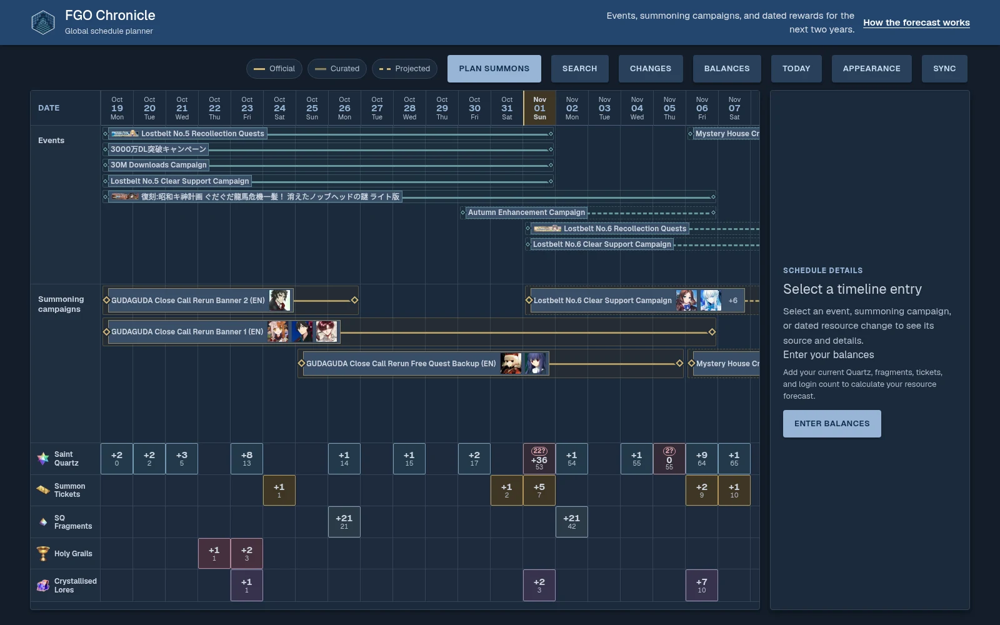

# FGO Chronicle

A schedule and resource planner for Fate/Grand Order Global. Find servant banners,
plan summons, and see how each plan affects your resources for later campaigns.

[Live app](https://fgo-chronicle.vercel.app) ·
[How the forecast works](https://fgo-chronicle.vercel.app/methodology)



## Features

- Events, summoning campaigns and rewards on one timeline, with Official, Curated
  and Projected dates.
- Servant search with alternative names, portraits and English Atlas Academy links where available.
- Resource forecasts based on starting balances, story progress and reward choices.
- Summon costs and target probabilities, with Saint Quartz, ticket and
  fragment balances before and after each saved plan.
- Plans saved in your browser, with optional Google sign-in to sync them to your account.
- A private curator dashboard for correcting records, moving event families and
  hiding incorrect entries while keeping their history.

## How it works

The importer combines Atlas Academy exports, Fandom pages, official announcements
and a banner spreadsheet. It stores imported records, official dates and curator
corrections separately. Each imported record has a consistent identifier, so later
imports update the same record instead of creating duplicates.

Database transactions keep related updates together. Change limits stop imports
that would alter too many records at once. Matching an announcement requires
evidence that it refers to the same event, not just similar dates.

The timeline, Changes screen and plan editor share one resource calculation.
It combines income, reward choices, fragment conversion and planned summon costs.
Plans on the same day use their creation order. Entries with only a date keep that calendar
day. Entries with an exact time display it in the player's timezone.

The app loads the timeline in date ranges, prioritising saved plans.
It waits for the required income data before showing calculated balances.
It fetches servant details in batches and caches them for reuse.

Account saves detect conflicting changes rather than silently overwriting them.
The server checks curator permissions before allowing edits.

## Stack

Next.js App Router, React, TypeScript, tRPC, Prisma, PostgreSQL, Auth.js and Zod.
The app runs on Vercel and has light and dark themes with a Material-inspired interface.

## Run locally

Use Node.js 24, npm and a development PostgreSQL database.

```sh
cp .env.example .env
npm ci
```

In `.env`, set `DATABASE_URL`, `AUTH_SECRET`, `AUTH_GOOGLE_ID` and `AUTH_GOOGLE_SECRET`.
For local Google sign-in, register `http://localhost:3000/api/auth/callback/google`
as the redirect URI. The app requires the Google configuration fields even if you
plan without signing in.

One migration explicitly revokes table access from `anon` and `authenticated`.
These database API roles must exist before migrations run on standalone PostgreSQL.
They are separate from app accounts and curator permissions.

```sh
npm run db:migrate
npm run dev
```

An empty database has no schedule data. Try the live app, or configure the imports
listed in `.env.example`. See [curator setup](docs/curator-dashboard.md)
for dashboard access.

## Banner data and imports

Banner records come from [Upcoming Banners by Servant](https://docs.google.com/spreadsheets/d/1rKtRX3WK9ZpbEHhDTy7yGSxYWIav1Hr_KhNM0jWN2wc/edit),
credited to Officerアルトリア, with maintainer contacts listed in the sheet.
Set `BANNER_SPREADSHEET_ID` in `.env` to the spreadsheet ID from its URL.

The sheet supplies featured servants and banner dates.

- `npm run data:import-banners` downloads and validates the sheet, then saves
  `data/banner-estimates.json`. Git ignores this file. The command does not change the database.
- `npm run data:sync` imports banners and runs the schedule sync. It writes to the
  configured database and does not support dry runs.
- `npm run data:sync-event-schedule -- --dry-run` previews schedule changes without
  publishing them. It does not import the spreadsheet.

Use a development database for local imports. The sheet must allow CSV downloads
without signing in. If you use a copy, keep the layout expected by
`src/server/services/banner-spreadsheet.ts`.

## Development checks

```sh
npm run check
npm run build
```

## Limits and credits

Global dates and rewards may differ from Japanese (JP) projections. Some entries
need curator review or a player choice about whether to include a reward.
Summon probabilities do not guarantee a result.

Data comes from Atlas Academy, the Fate/Grand Order Fandom wiki, official
announcements and the linked banner spreadsheet. Entries retain source links
where available. FGO Chronicle is an unofficial fan project. Game artwork and
names belong to their respective owners.

## License

Original project code is source-available under the
[PolyForm Noncommercial License 1.0.0](LICENSE). Use, modification and
redistribution are permitted for the purposes specified in the license.
Commercial use requires separate permission from the relevant rights holders.

This license does not cover third-party dependencies, game artwork or external
data. Those remain subject to their respective licenses and owners' rights.
